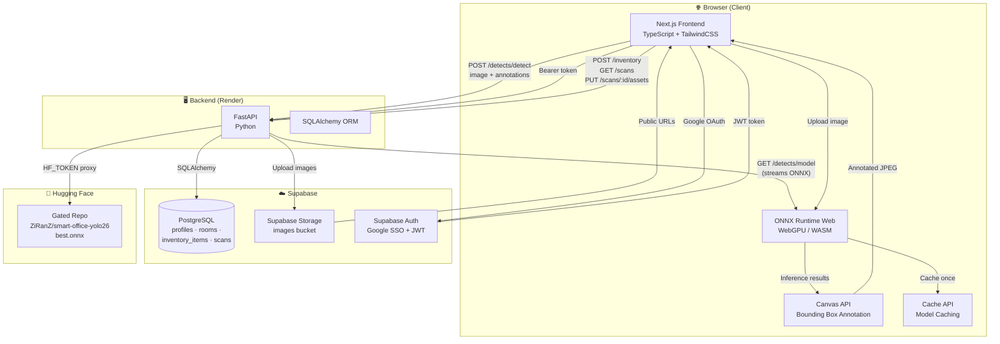
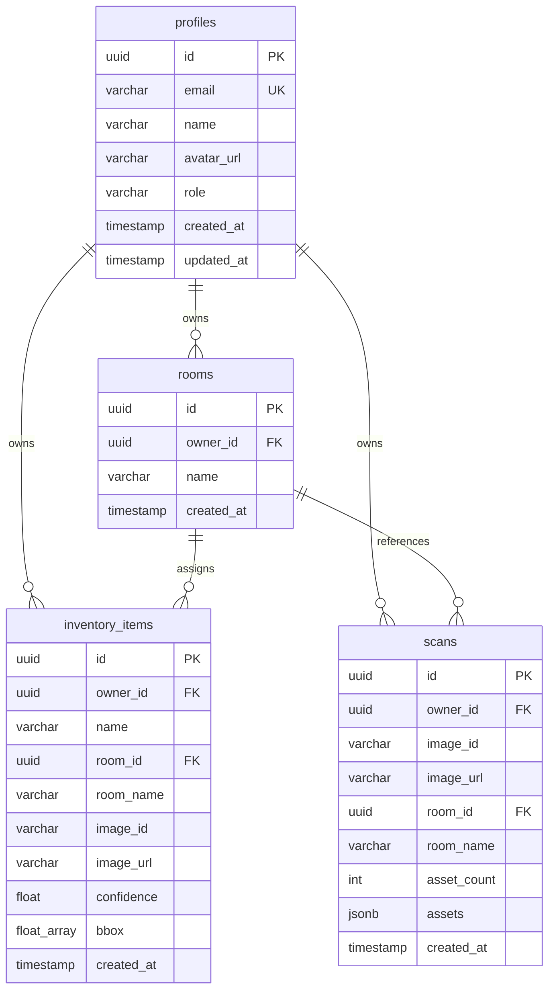

# Smart Office Asset Management AI

> A full-stack computer vision application that detects office assets (desks, chairs, monitors) in real-time using YOLO running entirely in the browser, then saves them into a per-room inventory with scan history and date-based analytics.

---

## Table of Contents

- [Project Overview](#project-overview)
- [Architecture Diagram](#architecture-diagram)
- [Technology Stack](#technology-stack)
- [Database Schema (ER Diagram)](#database-schema-er-diagram)
- [API Overview](#api-overview)
- [Screenshots](#screenshots)
- [Deployment Links](#deployment-links)
- [Future Improvements](#future-improvements)
- [Getting Started](#getting-started)

---

## Project Overview

**Smart Office Asset Management AI** is a full-stack web application that combines computer vision with inventory management. Users upload a photo of their office, and a YOLO object detection model — running **entirely in the browser** via ONNX Runtime Web — identifies desks, chairs, and computer monitors in real-time. The detected assets can then be manually corrected (rename, remove false positives, add missed items), assigned to a room, and saved into a personal inventory.

The inventory page provides a **per-date pie chart summary** (chairs/desks/monitors breakdown), **per-room asset counts**, and a **scan history** where each save is recorded chronologically. Users can also edit a scan's date and detection results after saving.

### Key Features

| Feature | Description |
|---------|-------------|
| 📸 **Smart Asset Scanning** | Upload an image and detect office assets using YOLO in the browser |
| 🧠 **Client-Side Inference** | ONNX Runtime Web runs on WebGPU/WASM — no server-side ML |
| ✏️ **Manual Correction** | Edit detection results before or after saving (rename, remove, add) |
| 📊 **Per-Date Pie Chart** | CSS conic-gradient chart showing chairs/desks/monitors for any date |
| 🏠 **Per-Room Summaries** | View asset counts grouped by room for the selected date |
| 📋 **Scan History** | Chronologically numbered scan records with editable dates and assets |
| 🔐 **Google SSO** | Authentication via Supabase Auth with PostgreSQL-backed profiles |
| ☁️ **Cloud Storage** | Original + annotated images stored in Supabase Storage |

---

## Architecture Diagram



### How Detection Works (Client-Side)

1. The browser fetches `best.onnx` from the backend proxy (`GET /detects/model`), which downloads it from the gated Hugging Face repo using a server-side `HF_TOKEN`.
2. The model is **cached via the Cache API** — downloaded once per browser.
3. ONNX Runtime Web runs inference using **WebGPU** (with **WASM** fallback).
4. Bounding boxes are drawn on a `<canvas>` in the browser.
5. The original image, annotated image, and detection JSON are sent to the backend for Supabase Storage.

> **Why client-side?** Moving ML inference to the browser keeps the backend lightweight (~512 MB Render free tier) — no PyTorch or GPU needed on the server.

---

## Technology Stack

| Layer | Technology | Purpose |
|-------|-----------|---------|
| **Frontend** | Next.js 14 (App Router) | React framework with SSR |
| **Frontend** | TypeScript | Type-safe development |
| **Frontend** | TailwindCSS | Utility-first styling (purple theme) |
| **AI / CV** | YOLO (best.onnx) | Object detection model |
| **AI / CV** | ONNX Runtime Web | In-browser inference (WebGPU/WASM) |
| **Backend** | Python 3.11 | Server runtime |
| **Backend** | FastAPI | Async API framework |
| **Backend** | SQLAlchemy 2.0 | ORM + database models |
| **Database** | PostgreSQL (Supabase) | Relational data storage |
| **Storage** | Supabase Storage | Image bucket (original + annotated) |
| **Auth** | Supabase Auth | Google SSO + JWT verification |
| **Model Hosting** | Hugging Face | Gated repo for `best.onnx` |
| **Deployment** | Render (backend) | FastAPI hosting |
| **Deployment** | Vercel (frontend) | Next.js hosting |

---

## Database Schema (ER Diagram)



### Table Descriptions

| Table | Purpose |
|-------|---------|
| `profiles` | User accounts synced from Google SSO (UUID, email, name, role) |
| `rooms` | User-defined rooms (e.g. "Meeting Room", "Room A") |
| `inventory_items` | Saved assets with owner, room, image, confidence, bbox, and timestamp |
| `scans` | Scan-history records summarizing each save action (asset names, count, room, date) |

---

## API Overview

### Detection Endpoints

| Method | Path | Description | Auth |
|--------|------|-------------|------|
| `GET` | `/detects/model` | Streams `best.onnx` to the browser (HF proxy) | No |
| `GET` | `/detects/models` | Static model descriptor (connection check) | No |
| `POST` | `/detects/detect` | Store original + annotated image + detections | No |

### Auth Endpoints

| Method | Path | Description | Auth |
|--------|------|-------------|------|
| `POST` | `/auth/google` | Verify Supabase token + upsert profile | Token |
| `GET` | `/auth/me` | Get current user's profile | Token |
| `PUT` | `/auth/me` | Update profile name | Token |

### Room Endpoints

| Method | Path | Description | Auth |
|--------|------|-------------|------|
| `POST` | `/rooms` | Create a new room | Token |
| `GET` | `/rooms` | List all rooms | Token |
| `PUT` | `/rooms/{room_id}` | Rename a room | Token |
| `DELETE` | `/rooms/{room_id}` | Delete a room | Token |

### Inventory Endpoints

| Method | Path | Description | Auth |
|--------|------|-------------|------|
| `POST` | `/inventory` | Bulk-save detected assets | Token |
| `GET` | `/inventory` | List all inventory items | Token |
| `PUT` | `/inventory/{item_id}` | Manually correct an item | Token |
| `DELETE` | `/inventory/{item_id}` | Remove an item | Token |

### Scan History Endpoints

| Method | Path | Description | Auth |
|--------|------|-------------|------|
| `GET` | `/scans` | List scan history | Token |
| `PUT` | `/scans/{scan_id}` | Change a scan's date | Token |
| `PUT` | `/scans/{scan_id}/assets` | Edit a scan's detection results | Token |

> All authenticated endpoints require `Authorization: Bearer <supabase_access_token>`

---

## Screenshots

> 📌 Screenshots will be added soon. Below are the key pages:

| Page | Description |
|------|-------------|
| **Landing Page** (docs/mainpage.png) | Hero section with "Start Scanning" and "View Inventory" buttons |
| **Scan Page** (docs/scans.png) | Image upload, YOLO detection with bounding boxes, editable asset list |
| **Inventory Page** (docs/inventory) | Pie chart summary, per-room cards, scan history with edit |

---

## Deployment Links

| Service | URL | Platform |
|---------|-----|----------|
| **Frontend** | [https://smart-office-asset.vercel.app/](https://smart-office-asset.vercel.app/) | Vercel |
| **Backend** | [https://smart-office-asset-management-ai.onrender.com/](https://smart-office-asset-management-ai.onrender.com/) | Render |
| **API Docs** | [https://smart-office-asset-management-ai.onrender.com/docs](https://smart-office-asset-management-ai.onrender.com/docs) | FastAPI Swagger UI |

---

## Future Improvements

- [ ] **Maintenance Scheduling** — Track service dates and warranty expirations with automated notifications
- [ ] **Multi-User Organizations** — Shared inventories across team members with role-based permissions
- [ ] **Mobile App** — React Native app for on-the-go scanning with camera integration
- [ ] **Batch Scanning** — Upload multiple images at once and process them in a single session
- [ ] **CSV/PDF Export** — Export inventory summaries and scan reports for auditing
- [ ] **Dashboard Analytics** — Trends over time (asset growth, room utilization, detection accuracy)
- [ ] **Custom Model Training** — In-app fine-tuning on user-corrected detections to improve accuracy
- [ ] **Barcode/QR Integration** — Link physical assets with digital records via scannable codes
- [ ] **Dark Mode** — Theme toggle for the purple UI
- [ ] **Offline Support** — PWA with offline detection using cached model

---

## Getting Started

### Prerequisites

- Python 3.11+
- Node.js 18+
- A Supabase project (for Auth, Storage, and PostgreSQL)
- A Hugging Face token (for the gated model repo)

### Backend Setup

```bash
cd backend
python -m venv office
office\Scripts\activate        # Windows
pip install -r requirements.txt
uvicorn main:app --reload
```

### Frontend Setup

```bash
cd frontend
npm install
npm run dev
```

### Environment Variables

See [`Dev.md`](Dev.md) for the complete environment variable reference.

---

## License

© 2026 Smart Office Asset Management AI. All rights reserved.